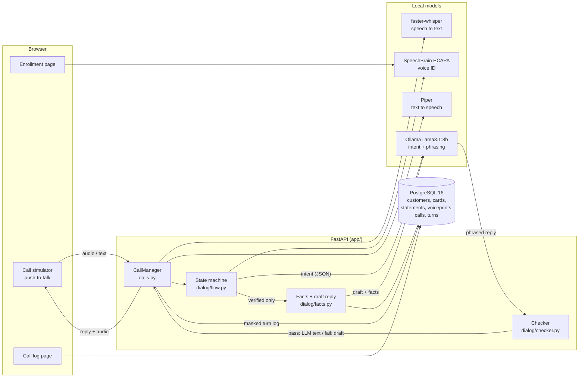
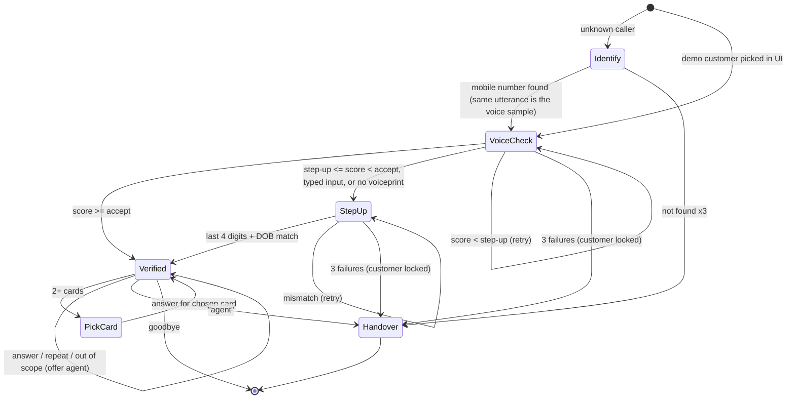

# Card Balance Voice Bot (local demo)

A teaching demo of a self-service voice journey for a (fictional) UAE bank. A caller asks
*"How much do I owe on my credit card and when is it due?"*. The bot:

1. verifies the caller with **Voice ID** (speaker verification), with a knowledge-based **step-up** when unsure,
2. reads the outstanding balance, minimum payment and due date from a **synthetic** card database,
3. speaks the answer back, and hands over to a (simulated) human agent when it can't help.

Everything runs on a laptop: no paid APIs, no real customers, banks or cards. Currency is AED.

> **Not production-ready.** Voice ID alone is not strong enough to protect a real bank account
> (see [Security notes](#security-notes)).

---

## Architecture



### Design principle: code for facts, LLM for language

| Job | Who does it |
|---|---|
| Read balance, minimum due, due date, overdue flag | **Code** (SQL) |
| Format amounts (`AED 4,250.75`) and dates (`25 November`) | **Code** |
| Write a correct draft answer | **Code** (`CardFacts.draft_reply`) |
| Classify intent (`CARD_BALANCE`, `DUE_DATE`, `BOTH`, `OTHER`, `AGENT`, plus `REPEAT`, `GOODBYE`) | **LLM**, JSON-schema output validated by Pydantic; keyword rules as fallback |
| Rephrase the draft into a warm spoken sentence | **LLM** |
| Check every amount and date in the reply against the database | **Code** (`check_reply`). If anything is wrong, missing or extra, the draft is spoken instead |
| Decide whether the caller is verified | **Code** only. The LLM never sees verification answers |

Money is stored as integer **fils** (1 AED = 100 fils), so there is no float rounding anywhere.

### Call flow



The question asked *before* verification ("how much do I owe…") is remembered and answered right after
verification passes, so a verified caller hears the answer straight away.

---

## Setup

Prerequisites: Python 3.11+, Docker Desktop, [Ollama](https://ollama.com), about 8 GB free disk.

```bash
python3 -m venv .venv
source .venv/bin/activate
pip install -r requirements-models.txt     # or requirements.txt for fake mode only
cp .env.example .env
```

### 1. Database

```bash
docker compose up -d
python scripts/seed.py
```

Postgres listens on **localhost:5434** (so it doesn't clash with other local Postgres containers).
`seed.py` resets the tables, keeps any voiceprints you enrolled, and writes the presenter's cheat sheet
(mobile numbers, DOBs, card last 4) to `data/demo_customers.csv`. Use `--reset-voiceprints` to wipe them too.

### 2. Models

```bash
python scripts/download_models.py          # Whisper + ECAPA + Piper voice, ~600 MB
ollama pull llama3.1:8b                    # ~4.9 GB
```

| Model | Where it goes | Setting in `.env` |
|---|---|---|
| faster-whisper `small` (CTranslate2, int8 on CPU) | Hugging Face cache | `WHISPER_MODEL` (`tiny`, `base`, `small`, `medium`) |
| SpeechBrain `spkrec-ecapa-voxceleb` | `models/ecapa/` | `ECAPA_SOURCE`, `ECAPA_SAVEDIR` |
| Piper `en_US-lessac-medium` (`.onnx` + `.onnx.json`) | `models/piper/` | `PIPER_VOICE_EN` |
| Ollama `llama3.1:8b` | Ollama | `OLLAMA_MODEL`, `OLLAMA_URL` |

To fetch them by hand instead: Piper voices are at
`huggingface.co/rhasspy/piper-voices` (`en/en_US/lessac/medium/`); ECAPA downloads itself on first use;
Whisper downloads itself on first use.

### 3. Run

```bash
uvicorn app.main:app
```

Open http://localhost:8000. Pages: **Call simulator** (`/`), **Voice enrollment** (`/enroll`), **Call log** (`/log`).
The browser only allows the microphone on `localhost` or HTTPS.

### Fake mode (no models, no microphone)

```bash
SPEECH_PROVIDER=fake LLM_PROVIDER=fake python scripts/seed.py --fake-voiceprints
SPEECH_PROVIDER=fake LLM_PROVIDER=fake uvicorn app.main:app
```

Type what the caller says in the text box. Fake voice ID returns a score of 0.80 (`FAKE_VOICE_SCORE`).

### Tests

```bash
pytest
```

Tests use SQLite in memory and fake STT, TTS, voice ID and LLM, so they need no Docker, models or microphone.
They cover intent detection, the verification thresholds (pass / step-up / fail, including the exact
boundaries), the checker rejecting wrong amounts, dates, extra numbers and missing facts, "no account data
before verification", one full call per path, the Ollama client with mocked HTTP, and the HTTP API.

---

## Demo customers

All synthetic. Mobile numbers follow the pattern `050 100 00NN`. Full details are in `data/demo_customers.csv`.

| # | Name | Scenario |
|---|---|---|
| 1 | Aisha Al Mansoori | Standard: AED 4,250.75, minimum AED 212.54 |
| 2 | Omar Haddad | Two cards: the bot asks which one |
| 3 | Priya Nair | Payment overdue |
| 4 | Rashid Al Suwaidi | Zero balance |
| 5 | Fatima Khan | Card blocked |
| 6 | Daniel Okafor | No voiceprint: always step-up |
| 7–20 | various | Standard, random balances |

Minimum payment = 5% of the balance (at least AED 100, never more than the balance).
Due dates are relative to the day you run `seed.py` (+15 days; overdue = −5 days).

---

## 5-minute demo script

**Before the audience arrives:** `docker compose up -d`, `python scripts/seed.py`, Ollama running,
`uvicorn app.main:app`. On the **Voice enrollment** page, enroll **Aisha (1)** and **Omar (2)** with your own
voice (consistency should be above about 0.6). Keep `data/demo_customers.csv` open.

1. **Happy path (1 min).** Call simulator, pick *Aisha*, Start call. Hold the button and say
   *"How much do I owe on my credit card and when is it due?"*
   Point out: the voice score passes the green threshold, the caller's name appears only now,
   the reply comes from the LLM and was checked, and the amounts are read as "dirhams and fils".
   Say *"Can you repeat that?"*, then *"No thanks, goodbye"*. Outcome: **served**.
2. **Impostor (1 min).** Pick *Aisha* again and ask a colleague to speak (or disguise your voice).
   The score falls in red or amber. Nothing about the account is said. In amber, the bot asks for the
   last 4 digits and DOB; answer wrongly twice more and the account **locks** and hands over with
   `VERIFY_FAILED_LOCKED`. Use **Unlock** to reset.
3. **Step-up (1 min).** Pick *Priya* (not enrolled) or type instead of speaking. The bot goes straight to
   step-up. Read her last 4 digits and DOB from the cheat sheet. Answer: balance plus **overdue**.
4. **Two cards plus handover (1 min).** Pick *Omar*, ask for the balance, choose a card by its last 4 digits.
   Then say *"I want to increase my credit limit"*: out of scope, so the bot offers an agent. Say *"yes"*.
   Outcome: **handed over** (`OUT_OF_SCOPE`).
5. **Call log (1 min).** Open **Call log** and click a call. Show the masked transcripts (step-up answers are
   never stored), intent, voice score, model and prompt version, and latency per stage.
   Bonus: *"Unknown caller"*, then say *"050 100 0001"*. The mobile-number utterance both identifies and
   verifies Aisha.

---

## Security notes

- **Voice ID is not enough on its own.** Recordings can be replayed and voices can be cloned (deepfakes).
  A production system would add liveness / anti-spoofing detection (e.g. AASIST-style models), random
  challenge phrases, caller-line and device signals, fraud scoring, and keep a step-up factor such as an
  OTP for anything sensitive. This demo keeps a knowledge-based step-up to show the pattern, but card
  digits and DOB are weak secrets too.
- **No account data before verification.** Enforced in code: `CallFlow._answer` raises `NotVerifiedError`
  unless the call is verified, and a test walks every pre-verification state checking that no amount is spoken.
  The UI only learns the caller's name after verification.
- **The LLM is not a security boundary.** Identification and step-up answers (mobile number, card digits, DOB)
  are parsed by code and never sent to the LLM; requests for an agent before verification are caught by keyword rules. In testing, a prompt-injection
  utterance could change the intent label, but it cannot skip verification or change the numbers spoken
  (the checker would reject them).
- **Never spoken:** full card number, CVV, full DOB. Only the last 4 digits of a card are used.
- **Rate limiting:** 3 failed verifications (voice or step-up) lock the customer for `LOCK_MINUTES`,
  and the call is handed over. A new call for a locked customer goes straight to an agent.
- **PII in logs:** mobile and card numbers are masked to the last 2 digits, dates with a year become `[DATE]`,
  and identification / step-up answers are replaced entirely. Mobile numbers are stored only as a salted hash
  plus a masked copy.
- **Demo shortcuts:** call state is kept in memory (one server process), and the pages have no login or HTTPS.

## Tuning thresholds

`VOICE_ACCEPT_THRESHOLD=0.55` and `VOICE_STEPUP_THRESHOLD=0.40` are cosine scores. With ECAPA, the same speaker
usually scores above 0.6 on a clean laptop mic and a different speaker below 0.3, but this depends on the mic
and the room. Enroll a few people, make some calls, read the scores in the call log, and move the thresholds.
Raising *accept* means fewer impostors get through and more genuine callers go to step-up.

## Adding Arabic later

Language is a setting (`LANGUAGE`), and everything language-specific is keyed by it:

- `app/dialog/messages.py`: add an `"ar"` block of bot phrases
- `prompts/ar/intent.v1.txt`, `prompts/ar/reply.v1.txt`: Arabic prompts (the labels stay in English)
- `PIPER_VOICE_AR`: an Arabic Piper voice (e.g. `ar_JO-kareem-medium`), plus a `piper_voice_ar` field in `config.py`
- `app/speech/stt.py`: an Arabic initial prompt (Whisper already supports Arabic)
- `app/speech/speakable.py`: Arabic number words for amounts and dates
- `app/dialog/parsing.py` and `app/llm/rules.py`: Arabic digit words and keywords
- The checker works on digits, so ask the LLM to keep Western digits in the reply

## Project layout

```
app/
  main.py              FastAPI app, pages and API
  calls.py             CallManager: audio -> STT -> flow -> TTS, turn logging
  dialog/flow.py       call state machine
  dialog/facts.py      facts from the DB, formatting, draft reply
  dialog/checker.py    amount/date checker
  dialog/answer.py     LLM phrasing with checker and fallback
  dialog/verification.py  thresholds, cosine, voiceprint averaging
  dialog/parsing.py    mobile / card digits / DOB from transcripts
  dialog/messages.py   bot phrases per language
  speech/              faster-whisper, Piper, ECAPA, fakes, speech-friendly text
  llm/                 Ollama client, fake LLM, keyword rules, prompt loader, schemas
  models.py, repo.py, db.py, seed_data.py, identity.py, logging_utils.py, providers.py, config.py
  static/              call.html, enroll.html, log.html
prompts/en/            versioned prompts (the version is logged with every turn)
scripts/               seed.py, download_models.py
tests/
```

## Troubleshooting

- **Port already in use:** change the host port in `docker-compose.yml` and `DATABASE_URL`.
- **Docker says "all predefined address pools have been fully subnetted":** the compose file already uses the
  default bridge network to avoid this. `docker network prune` frees unused networks if you need to.
- **`CERTIFICATE_VERIFY_FAILED` when downloading on macOS:** run `Install Certificates.command` from your
  Python folder (python.org builds), or use the download script, which goes through `huggingface_hub`.
- **`hf_hub_download() got an unexpected keyword argument 'use_auth_token'`:** SpeechBrain 1.0.x needs
  `huggingface_hub<1.0` (already pinned in `requirements-models.txt`).
- **No microphone prompt:** open the app on `http://localhost:8000`, not an IP address.
- **First reply is slow:** the LLM is warmed up at startup, but Whisper's first run also takes a moment.
